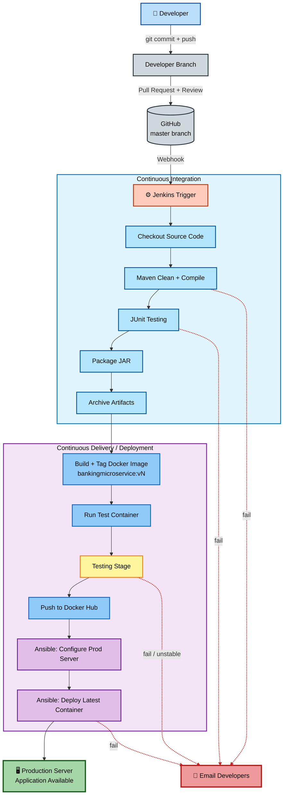
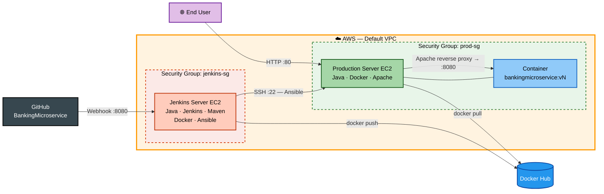
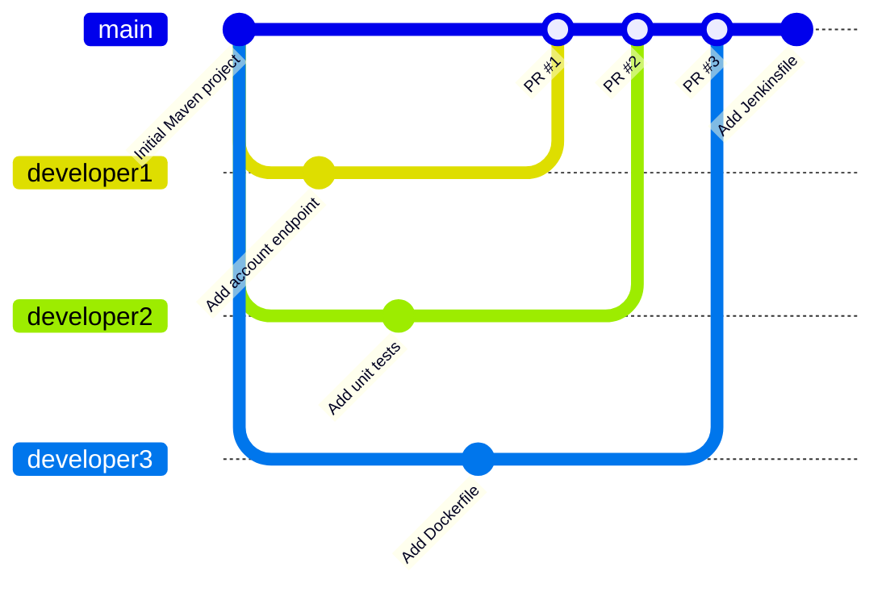

# 🏦 Banking Microservices CI/CD Automation — DevOps Capstone Project


> An end-to-end DevOps capstone project that automates the full software delivery lifecycle for a **Java-based banking microservice** — from a developer's `git commit` to a running container on a **production Linux server in AWS**. The pipeline uses **Git & GitHub** for source control, **Jenkins** for CI/CD, **Maven & JUnit** for build and test, **Docker** for containerization, **Ansible** for configuration management, and **email notifications** for fast feedback when anything fails.

---

## 📺 [Watch Me Build the Project Here](#)

> 🔗 *Walkthrough video link will be added once the project is complete.*

## 📋 Project Overview

| Field | Value |
| --- | --- |
| **Project type** | End-to-End DevOps Implementation (Capstone) |
| **Industry** | Banking & Financial Services |
| **Cloud platform** | AWS — Amazon EC2 (Ubuntu) |
| **Core tools** | Git · GitHub · Jenkins · Maven · JUnit · Docker · Docker Hub · Ansible · Apache HTTP Server |
| **Time to complete** | ~15–20 hours across multiple sessions |
| **Estimated cost** | Varies by EC2 instance size and hours running — **stop instances when idle** and check the [AWS Pricing Calculator](https://calculator.aws/) |
| **Career relevance** | DevOps Engineer · Cloud Engineer · Build & Release Engineer · Site Reliability Engineer |

---

## 🧩 The Business Problem This Project Solves

**ABC Technologies Pvt. Ltd.** develops banking applications for a global banking client. The team follows Agile, but almost every software delivery activity is still done **by hand**. The client is migrating its monolithic application into **Java-based microservices using REST APIs** — and as developers and services multiply, manual delivery has become slow, error-prone, and difficult to manage.

> **Scenario:** Three developers finish their features on the same afternoon. One emails a ZIP file, one pushes straight to `master`, and one asks an operations engineer to "just copy the JAR to the server." The ops engineer builds the image on their own laptop, forgets which version is running in production, and overwrites the working container. The release breaks, there is no record of what changed, and no fast way to roll back. A one-hour release turns into a late-night outage.

### Existing challenges

| Challenge | How this project addresses it |
| --- | --- |
| Manual code integration from multiple developers | Developer branches + pull requests into `master` |
| No centralized version control strategy | GitHub repository with a defined branch strategy |
| Manual application builds | Maven builds triggered automatically by Jenkins |
| Manual testing process | JUnit tests run on every pipeline execution |
| Manual Docker image creation | Jenkins builds and tags images automatically |
| Manual deployment to production | Ansible deploys the latest container to the production server |
| No automated rollback or versioning | Every image tagged `v<BUILD_NUMBER>` — previous versions remain available |
| Lack of deployment consistency | Same Dockerfile, same playbook, same steps — every time |
| Increased release time | Commit-to-production in minutes, not hours |
| Higher probability of production errors | Pipeline stops on failed compile/tests; developers are emailed immediately |

### How this project maps to real roles

| Role | How this project applies |
| --- | --- |
| **DevOps Engineer** | Designing and maintaining the CI/CD pipeline end to end |
| **Build & Release Engineer** | Maven builds, artifact versioning, and release tagging |
| **Cloud Engineer** | Provisioning and securing EC2 instances, security groups, and SSH access |
| **Site Reliability Engineer** | Health checks, repeatable deployments, and rollback-ready image versions |

---

## 🎯 What You Will Learn

| Skill | Real-world application |
| --- | --- |
| **Git branching strategy** with pull requests | How engineering teams integrate code from many developers safely |
| **Maven build automation** | Dependency resolution, compilation, testing, and packaging in one repeatable command |
| **JUnit unit testing** in CI | Catching defects before they ever reach a server |
| **Jenkins pipelines** (GUI jobs and Jenkinsfile) | The most widely used open-source CI/CD automation server |
| **Docker image versioning** | Immutable, traceable releases (`v1`, `v2`, `v3`...) |
| **Ansible configuration management** | Configuring servers as code instead of by hand |
| **Automated deployment** to a production server | Zero-touch releases with consistent results |
| **Email notifications** on failure | Fast feedback loops so developers fix issues immediately |

---

## 🏗️ Architecture

### Complete CI/CD Pipeline

How a single commit moves from a developer's laptop to production.



### AWS Infrastructure

Two EC2 instances: one CI/CD server and one production server.



### Git Branching Strategy



> ℹ️ The assignment uses `master` as the integration branch. Mermaid labels it `main`; the strategy is the same.

---

## 📁 Repository Structure

```text
BankingMicroservice/
├── src/
│   ├── main/java/com/abc/banking/
│   │   └── App.java
│   └── test/java/com/abc/banking/
│       └── AppTest.java
├── ansible/
│   ├── ansible.cfg
│   ├── inventory.ini
│   ├── setup-production.yml
│   ├── deploy.yml
│   └── files/
│       └── bankingmicroservice.conf
├── screenshots/
├── pom.xml
├── Dockerfile
├── Jenkinsfile
└── README.md
```

> ℹ️ Maven expects source code under `src/main/java/<package>/` and tests under `src/test/java/<package>/`. The capstone brief shows a simplified tree; this is the standard Maven layout.

---

## ✅ Prerequisites

### Accounts

- [ ] **AWS account** with permission to launch EC2 instances, create security groups, key pairs, and Elastic IPs
- [ ] **AWS billing alert / budget** configured (Billing → Budgets) to avoid surprise charges
- [ ] **GitHub account** (repository `BankingMicroservice` will be created in Phase 1)
- [ ] **Docker Hub account** and a **personal access token** (Account Settings → Personal access tokens)
- [ ] **Gmail account** with **2-Step Verification** enabled and an **App Password** generated (for Jenkins email)

### Local workstation

- [ ] **Git** installed and configured (`git config --global user.name` / `user.email`)
- [ ] **SSH client** (Terminal on macOS/Linux, or Windows Terminal / PowerShell OpenSSH)
- [ ] **Code editor** (VS Code or similar) for Java, YAML, and Markdown files
- [ ] **Modern web browser** for the AWS Console, Jenkins UI, GitHub, and Docker Hub
- [ ] *(Optional)* **JDK 21** and **Maven** locally, to build and test before pushing

### AWS infrastructure (created in Phase 0)

- [ ] **EC2 key pair** (`.pem`) downloaded and stored securely (`chmod 400` on macOS/Linux)
- [ ] **Jenkins server** — Ubuntu Server 24.04 LTS, `t3.medium`, Elastic IP attached
- [ ] **Production server** — Ubuntu Server 24.04 LTS, `t3.small` or `t3.micro`
- [ ] **Security groups** `jenkins-sg` and `prod-sg` with the ports listed in Phase 0

### Software — Jenkins server

| Software | Install command / source | Used in |
| --- | --- | --- |
| OpenJDK 21 | `sudo apt install -y openjdk-21-jdk` | Jenkins runtime + Maven builds |
| Git | `sudo apt install -y git` | Source checkout |
| Maven | `sudo apt install -y maven` | Build, test, package |
| Jenkins (LTS) | [Official Linux install guide](https://www.jenkins.io/doc/book/installing/linux/) | CI/CD orchestration |
| Docker Engine | `sudo apt install -y docker.io` | Image build and test container |
| Ansible | `sudo apt install -y ansible` | Production configuration and deployment |
| curl | `sudo apt install -y curl` | Container health checks |

### Software — Production server (installed by Ansible in Phase 7)

| Software | Purpose |
| --- | --- |
| OpenJDK 21 JRE | Java runtime (required by the brief) |
| Docker Engine | Runs the application container |
| Apache HTTP Server (`apache2`) | Reverse proxy from port 80 to the container |
| Python 3 | Required by Ansible on managed nodes — preinstalled on Ubuntu 24.04 |

### Jenkins plugins

- [ ] Git · GitHub · Pipeline · Maven Integration · JUnit · Email Extension · Build Pipeline · Credentials Binding

### Credentials & secrets to have ready

| Item | Stored where |
| --- | --- |
| Docker Hub username + access token | Jenkins Credentials → `dockerhub-creds` |
| Gmail address + App Password | Jenkins → Extended E-mail Notification |
| EC2 private key for the production server | `/var/lib/jenkins/.ssh/prod-key.pem` (`chmod 600`, owner `jenkins`) |
| Developer email addresses | `DEV_EMAILS` in the Jenkinsfile |

> ⚠️ Never commit keys, tokens, or passwords to GitHub. Add `*.pem` and any secrets files to `.gitignore`.

### Knowledge

- [ ] Basic Linux command line (`cd`, `ls`, `sudo`, `systemctl`, file permissions)
- [ ] Git basics — commit, branch, push, pull request, merge
- [ ] YAML syntax (Ansible playbooks)
- [ ] Basic Java and Maven project structure
- [ ] Docker basics — images, containers, tags, ports
- [ ] Networking basics — ports, SSH, HTTP, security groups

---

## ☁️ Phase 0 — Provision AWS Infrastructure

1. Launch two **Ubuntu Server 24.04 LTS** EC2 instances:

| Instance | Suggested size | Purpose |
| --- | --- | --- |
| `jenkins-server` | `t3.medium` (2 vCPU / 4 GiB) | Jenkins, Maven, Docker, Ansible — Jenkins + Maven builds need more than 1 GiB of RAM |
| `production-server` | `t3.small` or `t3.micro` | Runs the application container behind Apache |

2. Configure security groups:

| Security group | Port | Source | Reason |
| --- | --- | --- | --- |
| `jenkins-sg` | 22 | My IP | SSH administration |
| `jenkins-sg` | 8080 | My IP + [GitHub webhook IP ranges](https://api.github.com/meta) | Jenkins UI and webhooks |
| `prod-sg` | 22 | `jenkins-sg` | Ansible SSH from Jenkins only |
| `prod-sg` | 80 | 0.0.0.0/0 | Public application access via Apache |

3. Allocate an **Elastic IP** to `jenkins-server` so the GitHub webhook URL doesn't change when the instance restarts.

> ⚠️ **Cost control:** Stop both instances when you're not working on the project. Release the Elastic IP when the project is finished.

---

## 🌿 Phase 1 — Source Code Management (Git & GitHub)

1. Create a GitHub repository named **`BankingMicroservice`**.
2. Initialize the local repository and connect it to GitHub:

```bash
git init
git add .
git commit -m "Initial commit: Maven banking microservice"
git branch -M master
git remote add origin https://github.com/glenpagesr-dev/BankingMicroservice.git
git push -u origin master
```

3. Create one branch per developer:

```bash
for dev in developer1 developer2 developer3; do
  git checkout -b "$dev" master
  git push -u origin "$dev"
done
git checkout master
```

4. Each developer commits and pushes to their own branch, then opens a **Pull Request** into `master`.
5. Review each pull request and **merge approved changes** into `master`.
6. Verify the full history is preserved:

```bash
git log --oneline --graph --all
```

---

## 🔨 Phase 2 — Build Automation (Maven)

### Install Java, Maven, and Git on the Jenkins server

```bash
sudo apt update
sudo apt install -y openjdk-21-jdk maven git
java -version && mvn -version
```

### Key `pom.xml` settings

```xml
<properties>
  <maven.compiler.release>21</maven.compiler.release>
  <project.build.sourceEncoding>UTF-8</project.build.sourceEncoding>
</properties>

<dependencies>
  <dependency>
    <groupId>org.junit.jupiter</groupId>
    <artifactId>junit-jupiter</artifactId>
    <version>5.10.2</version>
    <scope>test</scope>
  </dependency>
</dependencies>

<build>
  <finalName>BankingMicroservice</finalName>
  <plugins>
    <plugin>
      <groupId>org.apache.maven.plugins</groupId>
      <artifactId>maven-surefire-plugin</artifactId>
      <version>3.2.5</version>
    </plugin>
    <plugin>
      <groupId>org.apache.maven.plugins</groupId>
      <artifactId>maven-jar-plugin</artifactId>
      <version>3.4.1</version>
      <configuration>
        <archive>
          <manifest>
            <mainClass>com.abc.banking.App</mainClass>
          </manifest>
        </archive>
      </configuration>
    </plugin>
  </plugins>
</build>
```

| Setting | Why it matters |
| --- | --- |
| `maven.compiler.release` | Must match the installed JDK — a mismatch causes `release version XX not supported` |
| `junit-jupiter` (test scope) | Maven downloads JUnit automatically; it is never packaged into the JAR |
| `finalName` | Produces `target/BankingMicroservice.jar` exactly as the brief requires |
| `mainClass` in the manifest | Makes the JAR executable with `java -jar` |

### Build locally

```bash
mvn clean package
ls target/BankingMicroservice.jar
ls target/surefire-reports/
```

**Expected output:** `target/BankingMicroservice.jar` plus JUnit test reports in `target/surefire-reports/`.

---

## ⚙️ Phase 3 — Continuous Integration (Jenkins)

### Install Jenkins

Follow the official Debian/Ubuntu instructions at [jenkins.io/doc/book/installing/linux](https://www.jenkins.io/doc/book/installing/linux/) — the repository signing key changes periodically, so always copy the current commands from the official page.

```bash
sudo systemctl enable --now jenkins
sudo cat /var/lib/jenkins/secrets/initialAdminPassword
```

Open `http://<JENKINS_ELASTIC_IP>:8080`, unlock Jenkins, and install the suggested plugins.

### Required plugins

| Plugin | Purpose |
| --- | --- |
| Git / GitHub | Checkout and webhook triggers |
| Pipeline | Declarative `Jenkinsfile` support |
| Maven Integration | Maven project type and tool configuration |
| JUnit | Publishes test results and marks builds unstable |
| Email Extension | Rich failure notifications (`emailext`) |
| Build Pipeline | Visual view of chained freestyle jobs |
| Credentials Binding | Injects Docker Hub credentials securely |

### Global configuration

1. **Manage Jenkins → Tools → Maven installations** → name it `Maven3` (points to the installed Maven).
2. **Manage Jenkins → Credentials** → add `dockerhub-creds` (Docker Hub username + access token).
3. In GitHub: **Settings → Webhooks → Add webhook** → `http://<JENKINS_ELASTIC_IP>:8080/github-webhook/` → content type `application/json`.

### CI stages

```text
Git Pull → Maven Clean → Maven Compile → JUnit Testing → Package Application → Archive Artifacts
```

The pipeline **stops immediately** if compilation fails or any unit test fails.

---

## 🐳 Phase 4 — Docker Integration

### Allow Jenkins to run Docker without `sudo`

```bash
sudo apt install -y docker.io
sudo usermod -aG docker jenkins
sudo systemctl restart jenkins
```

### Dockerfile

```dockerfile
FROM eclipse-temurin:21-jre
WORKDIR /app
COPY target/BankingMicroservice.jar app.jar
EXPOSE 8080
ENTRYPOINT ["java", "-jar", "app.jar"]
```

### Image versioning

Every successful build produces a new, uniquely tagged image using the Jenkins `BUILD_NUMBER` variable:

```text
bankingmicroservice:v1
bankingmicroservice:v2
bankingmicroservice:v3
```

The old container is removed and a new container always runs the **latest** image. Previous tags stay in Docker Hub, which makes **rollback** a single command.

---

## 🧪 Phase 5 — Automated Testing

A dedicated **Testing** stage runs after the image is built. For this capstone it is a dummy stage, plus a container smoke test against the `/health` endpoint.

| Result | Jenkins action |
| --- | --- |
| ✅ Passed | Continue to deployment |
| ⚠️ Unstable | Mark build **UNSTABLE**, skip deployment, email developers |
| ❌ Failed | Mark build **FAILED**, stop pipeline, email developers |

---

## 📧 Phase 6 — Email Notification

1. **Manage Jenkins → System → Extended E-mail Notification**:

| Field | Value |
| --- | --- |
| SMTP server | `smtp.gmail.com` |
| SMTP port | `465` |
| Use SSL | ✅ |
| Credentials | Gmail address + **App Password** |

> ⚠️ AWS restricts outbound traffic on **port 25** from EC2 by default — use port **465** (SSL) or **587** (TLS) instead.

2. Every failure email includes:

| Field | Jenkins variable |
| --- | --- |
| Project Name | `JOB_NAME` |
| Build Number | `BUILD_NUMBER` |
| Build Status | `currentBuild.currentResult` |
| Jenkins URL | `JENKINS_URL` |
| Console Output Link | `${BUILD_URL}console` |

---

## 🛡️ Phase 7 — Production Server Preparation (Ansible)

### Install Ansible on the Jenkins server

```bash
sudo apt install -y ansible
ansible --version
```

Copy the EC2 key pair to `/var/lib/jenkins/.ssh/prod-key.pem`, owned by `jenkins` with `chmod 600`.

### `ansible/inventory.ini`

```ini
[production]
prod-server ansible_host=<PROD_PRIVATE_IP> ansible_user=ubuntu ansible_ssh_private_key_file=/var/lib/jenkins/.ssh/prod-key.pem
```

### `ansible/ansible.cfg`

```ini
[defaults]
inventory = inventory.ini
host_key_checking = False
```

> ℹ️ `host_key_checking = False` is acceptable for a learning environment. In a real enterprise, add the server's host key to `known_hosts` instead.

### `ansible/setup-production.yml`

```yaml
- name: Prepare production server
  hosts: production
  become: true
  tasks:
    - name: Install Java, Docker, and Apache
      ansible.builtin.apt:
        name: [openjdk-21-jre-headless, docker.io, apache2]
        state: present
        update_cache: true

    - name: Start and enable Docker and Apache on boot
      ansible.builtin.service:
        name: "{{ item }}"
        state: started
        enabled: true
      loop: [docker, apache2]

    - name: Enable Apache reverse-proxy modules
      community.general.apache2_module:
        name: "{{ item }}"
        state: present
      loop: [proxy, proxy_http]
      notify: Restart Apache

    - name: Deploy reverse-proxy site config
      ansible.builtin.copy:
        src: files/bankingmicroservice.conf
        dest: /etc/apache2/sites-available/000-default.conf
      notify: Restart Apache

    - name: Verify Java version
      ansible.builtin.command: java -version
      register: java_ver
      changed_when: false

    - name: Verify Docker version
      ansible.builtin.command: docker --version
      register: docker_ver
      changed_when: false

    - name: Verify Apache status
      ansible.builtin.command: systemctl is-active apache2
      register: apache_status
      changed_when: false

    - name: Show verification results
      ansible.builtin.debug:
        msg:
          - "Java: {{ java_ver.stderr_lines[0] }}"
          - "Docker: {{ docker_ver.stdout }}"
          - "Apache: {{ apache_status.stdout }}"

  handlers:
    - name: Restart Apache
      ansible.builtin.service:
        name: apache2
        state: restarted
```

> ℹ️ `java -version` prints to **stderr**, which is why the playbook reads `stderr_lines`.

### `ansible/files/bankingmicroservice.conf`

```apache
<VirtualHost *:80>
    ProxyPreserveHost On
    ProxyPass        / http://127.0.0.1:8080/
    ProxyPassReverse / http://127.0.0.1:8080/
</VirtualHost>
```

---

## 🚀 Phase 8 — Production Deployment

### `ansible/deploy.yml`

```yaml
- name: Deploy Banking Microservice
  hosts: production
  become: true
  vars:
    container_name: bankingmicroservice
  tasks:
    - name: Pull latest image
      ansible.builtin.command: docker pull {{ image }}

    - name: Stop old container
      ansible.builtin.shell: docker stop {{ container_name }} || true

    - name: Remove old container
      ansible.builtin.shell: docker rm {{ container_name }} || true

    - name: Run new container
      ansible.builtin.command: >
        docker run -d --name {{ container_name }}
        --restart unless-stopped -p 127.0.0.1:8080:8080 {{ image }}

    - name: Verify application is available
      ansible.builtin.uri:
        url: http://localhost/health
        status_code: 200
      register: health
      retries: 5
      delay: 5
      until: health.status == 200
```

### Rollback

```bash
ansible-playbook ansible/deploy.yml -e image=<DOCKERHUB_USER>/bankingmicroservice:v<PREVIOUS_BUILD>
```

---

## 📜 Jenkinsfile — Pipeline as Code (Bonus)

```groovy
pipeline {
    agent any

    tools { maven 'Maven3' }

    environment {
        IMAGE_NAME = '<DOCKERHUB_USER>/bankingmicroservice'
        IMAGE_TAG  = "v${BUILD_NUMBER}"
        DEV_EMAILS = 'developer1@example.com,developer2@example.com,developer3@example.com'
    }

    triggers { githubPush() }

    stages {
        stage('Checkout') {
            steps {
                git branch: 'master', url: 'https://github.com/glenpagesr-dev/BankingMicroservice.git'
            }
        }
        stage('Maven Clean & Compile') {
            steps { sh 'mvn -B clean compile' }
        }
        stage('JUnit Testing') {
            steps { sh 'mvn -B test' }
            post { always { junit 'target/surefire-reports/*.xml' } }
        }
        stage('Package Application') {
            steps { sh 'mvn -B package -DskipTests' }
        }
        stage('Archive Artifacts') {
            steps { archiveArtifacts artifacts: 'target/BankingMicroservice.jar', fingerprint: true }
        }
        stage('Build Docker Image') {
            steps { sh 'docker build -t $IMAGE_NAME:$IMAGE_TAG -t $IMAGE_NAME:latest .' }
        }
        stage('Run Test Container') {
            steps {
                sh '''
                    docker rm -f banking-test || true
                    docker run -d --name banking-test -p 8081:8080 $IMAGE_NAME:$IMAGE_TAG
                    sleep 10
                    curl -fsS http://localhost:8081/health
                    docker rm -f banking-test
                '''
            }
        }
        stage('Testing') {
            steps { echo 'Testing is successful' }
        }
        stage('Push to Docker Hub') {
            when { expression { currentBuild.currentResult == 'SUCCESS' } }
            steps {
                withCredentials([usernamePassword(credentialsId: 'dockerhub-creds',
                                                  usernameVariable: 'DH_USER',
                                                  passwordVariable: 'DH_TOKEN')]) {
                    sh '''
                        echo "$DH_TOKEN" | docker login -u "$DH_USER" --password-stdin
                        docker push $IMAGE_NAME:$IMAGE_TAG
                        docker push $IMAGE_NAME:latest
                    '''
                }
            }
        }
        stage('Ansible: Configure Production') {
            when { expression { currentBuild.currentResult == 'SUCCESS' } }
            steps { sh 'cd ansible && ansible-playbook setup-production.yml' }
        }
        stage('Deploy to Production') {
            when { expression { currentBuild.currentResult == 'SUCCESS' } }
            steps { sh 'cd ansible && ansible-playbook deploy.yml -e image=$IMAGE_NAME:$IMAGE_TAG' }
        }
    }

    post {
        unsuccessful {
            emailext(
                to: "${DEV_EMAILS}",
                subject: "${currentBuild.currentResult}: ${JOB_NAME} #${BUILD_NUMBER}",
                body: """Project Name: ${JOB_NAME}
Build Number: ${BUILD_NUMBER}
Build Status: ${currentBuild.currentResult}
Jenkins URL: ${JENKINS_URL}
Console Output: ${BUILD_URL}console"""
            )
        }
        always {
            sh 'docker image prune -f || true'
        }
    }
}
```

> ℹ️ The `when` conditions guarantee that an **UNSTABLE** build never reaches production. The `unsuccessful` post condition covers failed, unstable, and aborted builds.

---

## 🏅 Bonus Tasks

- [ ] Jenkinsfile (Pipeline as Code)
- [ ] Docker Hub Integration
- [ ] GitHub Webhook
- [ ] SonarQube Code Quality Analysis
- [ ] JFrog Artifactory Artifact Repository
- [ ] Blue-Green Deployment
- [ ] Docker Compose
- [ ] Kubernetes Deployment
- [ ] Helm Charts
- [ ] Prometheus Monitoring
- [ ] Grafana Dashboard

---

## 💡 DevOps Concepts to Know

| Term | Definition | Where it appears in this project |
| --- | --- | --- |
| **Continuous Integration (CI)** | Automatically building and testing every change merged into the shared branch | Jenkins checkout → Maven → JUnit |
| **Continuous Delivery / Deployment (CD)** | Automatically releasing every passing build to an environment | Docker build → Ansible deploy |
| **Artifact** | A versioned, deployable build output | `BankingMicroservice.jar`, Docker images |
| **Immutable image** | An image that is never changed after it is built — a new version gets a new tag | `bankingmicroservice:vN` |
| **Configuration Management** | Defining server state as code so every server is configured the same way | Ansible playbooks |
| **Idempotency** | Running the same automation twice produces the same result with no extra changes | Ansible `apt` and `service` modules |
| **Webhook** | An HTTP callback GitHub sends to Jenkins when code is pushed | GitHub → `/github-webhook/` |
| **Rollback** | Returning production to a known-good previous version | Redeploying an earlier `vN` tag |

---

## 🧰 Troubleshooting

| Symptom | Likely cause | Fix |
| --- | --- | --- |
| `release version XX not supported` | `maven.compiler.release` doesn't match the installed JDK | Set the `pom.xml` release to the JDK version from `java -version` |
| `permission denied ... docker.sock` | The `jenkins` user isn't in the `docker` group | `sudo usermod -aG docker jenkins` then restart Jenkins |
| Webhook never triggers the build | Jenkins has no public IP, or port 8080 is blocked | Use an Elastic IP and open 8080 to GitHub's webhook ranges, or fall back to **Poll SCM** |
| Ansible `UNREACHABLE` | SSH key path, permissions, or security group | `chmod 600` the key; allow port 22 from `jenkins-sg` |
| Emails never arrive | Port 25 blocked on EC2, or a normal Gmail password used | Use port 465/587 with a Gmail **App Password** |
| Container exits immediately | The application isn't a long-running service | Make sure `App.java` starts an HTTP server and keeps running |

---

## 📸 Portfolio Evidence

> Screenshots are stored in the `/screenshots` folder. Each section explains what the artifact proves and why it matters in an enterprise environment.

### 1. GitHub Branch Strategy & Commit History


*Screenshot pending.* Demonstrates **source control discipline** — independent developer branches, reviewed pull requests, and a complete audit trail of every change merged into `master`.

### 2. Maven Build & JUnit Results


*Screenshot pending.* Demonstrates **build automation** — dependencies resolved, code compiled, tests executed, and `BankingMicroservice.jar` produced with zero manual steps.

### 3. Jenkins Pipeline Stage View


*Screenshot pending.* Demonstrates **continuous integration** — every stage from checkout to deployment visible in one view, with failures stopping the pipeline before they reach production.

### 4. Versioned Docker Images


*Screenshot pending.* Demonstrates **release versioning** — each build produces a uniquely tagged image in Docker Hub, enabling traceability and rollback.

### 5. Failure Email Notification


*Screenshot pending.* Demonstrates **fast feedback** — developers receive the project name, build number, status, and console link the moment a build fails.

### 6. Ansible Playbook Run


*Screenshot pending.* Demonstrates **configuration management** — Java, Docker, and Apache installed, started, enabled on boot, and verified on the production server automatically.

### 7. Application Running in Production


*Screenshot pending.* Demonstrates **automated deployment** — the latest container running on the production EC2 instance and reachable through Apache.

---

## 🛠️ Tools & Technologies


- **Git & GitHub** — version control, branching, pull requests, webhooks
- **Maven & JUnit** — build automation and unit testing
- **Jenkins** — CI/CD orchestration (freestyle jobs and Jenkinsfile)
- **Docker & Docker Hub** — containerization and image registry
- **Ansible** — production server configuration and deployment
- **Apache HTTP Server** — reverse proxy in front of the application container
- **AWS EC2** — Jenkins and production server hosting

---

## 🔗 Related Projects

- [ServiceNow ITSM](https://github.com/glenpagesr-dev/Servicenow-ITSM) — incident, change, and service catalogue management
- [Azure AD / Entra ID Administration](https://github.com/glenpagesr-dev/azure-ad-admin-lab) — identity, RBAC, and directory management

---

## 👤 Author

**Glen Page** — DevOps Engineer. Active DoD Top Secret Clearance, CompTIA Security+ certified, with hands-on Microsoft Azure / AWS experience and CI/CD pipeline project work using Jenkins, Docker, and Ansible.

- GitHub: [@glenpagesr-dev](https://github.com/glenpagesr-dev)
- LinkedIn: [glen-page-862730246](https://www.linkedin.com/in/glen-page-862730246)

---

> ℹ️ **Note:** This capstone project is built for learning and portfolio purposes. **ABC Technologies Pvt. Ltd.** and its banking client are a fictional case study. All infrastructure runs in a personal AWS account; replace placeholders such as `<DOCKERHUB_USER>`, `<PROD_PRIVATE_IP>`, and developer email addresses with your own values.
